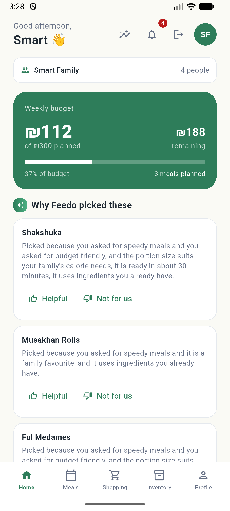
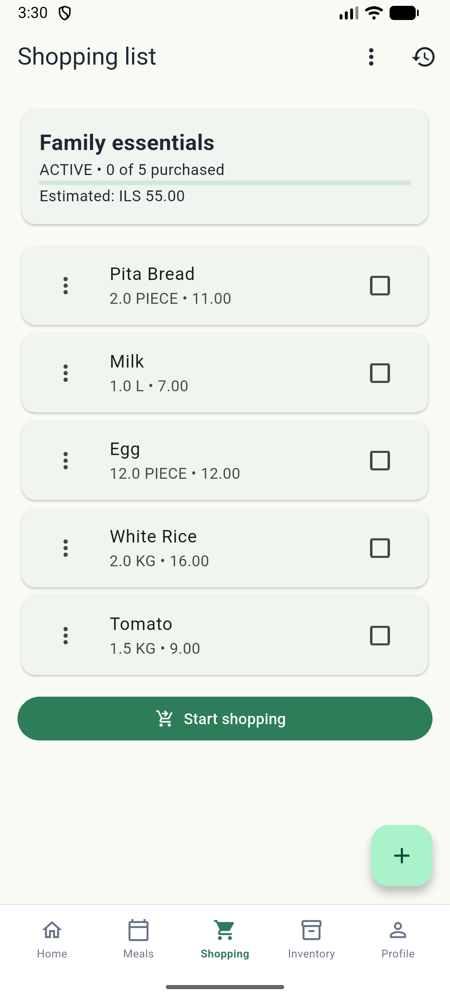
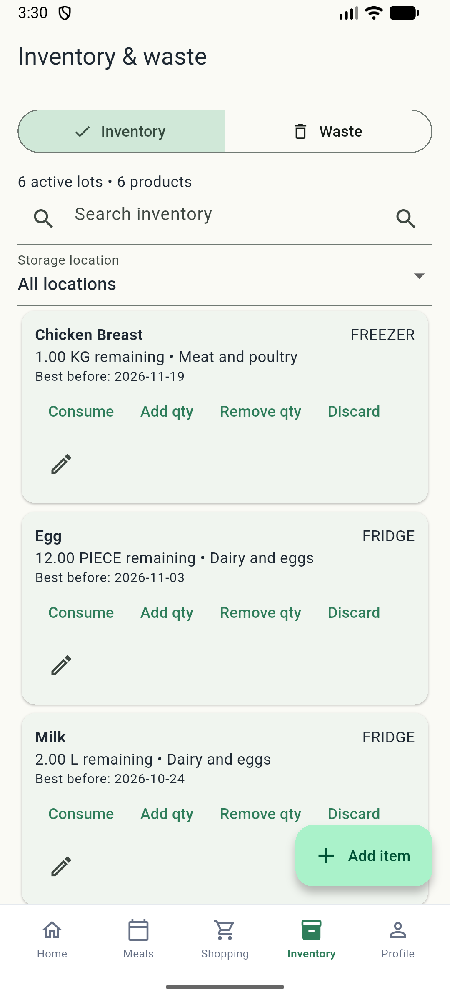
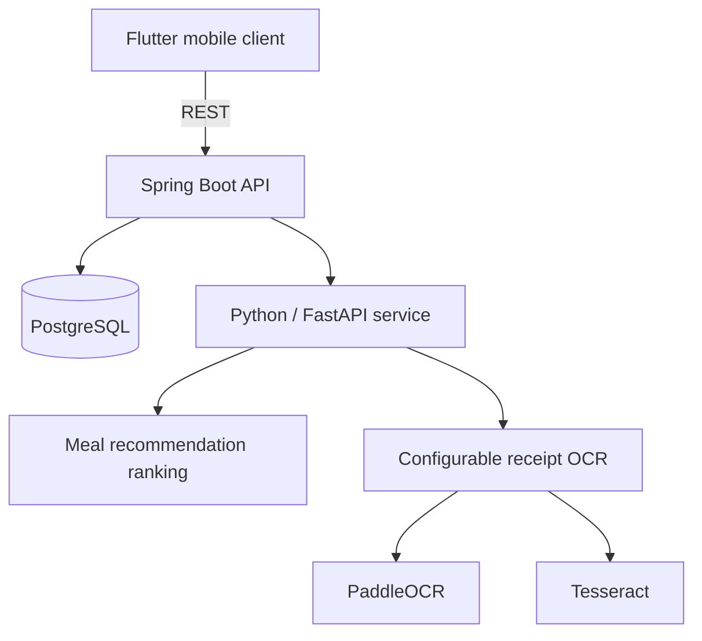
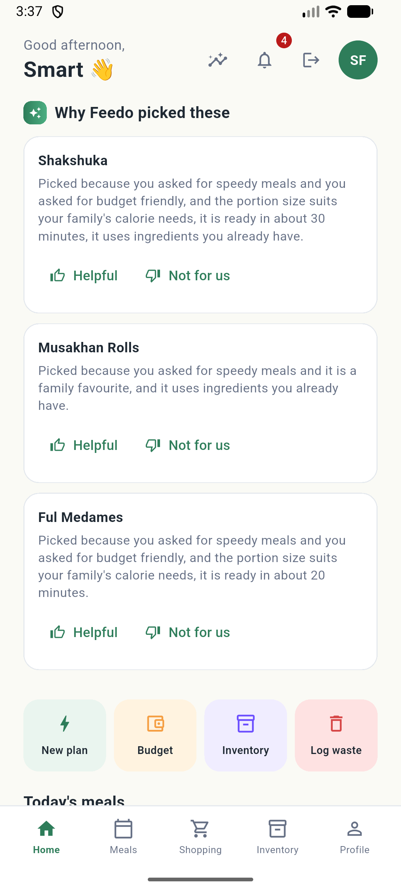
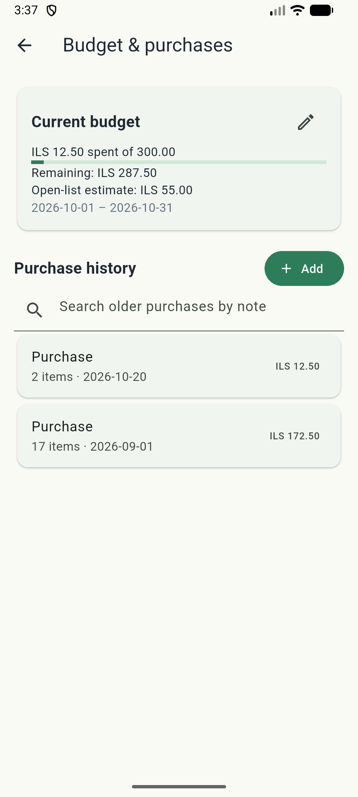
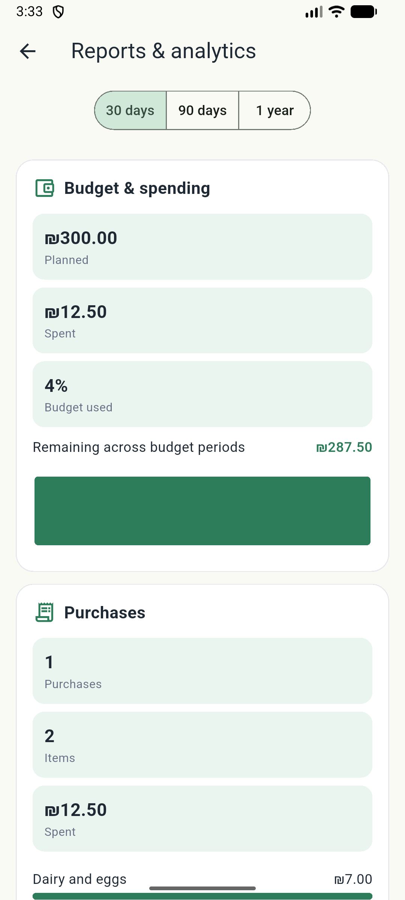
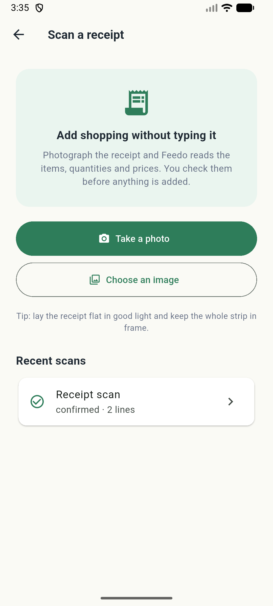
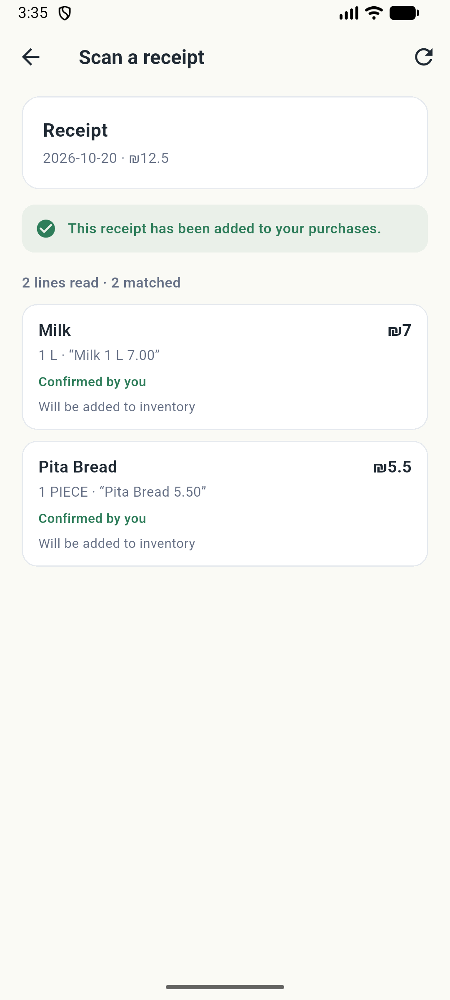

  
  <h1>FEEDO</h1>
  
<strong>Plan meals. Shop with context. Know what is at home.</strong>

  
A household food management app connecting meal decisions, grocery shopping, receipts, and inventory.

  
<a href="docs/features.md">Product features</a> · <a href="docs/architecture.md">Architecture</a> · <a href="docs/technical-overview.md">Technical overview</a>

## Overview

Household food decisions are connected: a meal plan changes the shopping list, purchases affect the budget, and groceries become stock to use before buying more. FEEDO brings these steps into one mobile experience, with household preferences and existing inventory providing context for meal recommendations.

Built collaboratively by Tariq Ladadweh and Muhammad Aljamal.

> FEEDO's application source code is maintained privately. This repository is a public project showcase containing selected documentation, architecture information, screenshots, and product highlights.

## Product preview

<table>
  <tr>
    <td align="center" width="33%"> <strong>Household dashboard</strong></td>
    <td align="center" width="33%"> <strong>Shopping with context</strong></td>
    <td align="center" width="33%"> <strong>Stock at a glance</strong></td>
  </tr>
</table>

Actual Flutter app captures using a fictional household. The dashboard's “Weekly budget” card is a **meal-plan estimate**, not actual spending. Budget and Reports show recorded spending separately. [Screenshot context](assets/screenshots/README.md).

## Key features

| Experience | What users can do |
| --- | --- |
| Meal planning | Browse meals, generate household-aware suggestions, review recommendation reasons, adjust servings, and confirm a plan. |
| Shopping | Build and manage grocery lists with quantities and estimated costs; record purchases separately from planned shopping. |
| Household inventory | Track quantities and storage locations, record consumption or waste, and maintain best-before information. |
| Receipt intelligence | Upload a receipt, review extracted lines and catalogue suggestions, resolve uncertain quantities and amounts, and confirm selected food items into purchases and inventory. |
| Budget and reports | Compare recorded purchases with the household budget and review spending and waste information. |
| Household experience | Maintain household members and preferences, manage an authenticated account, and read in-app notifications. FEEDO supports both Arabic and English, including full right-to-left support for Arabic. |

[Explore the product workflows →](docs/features.md)

## Receipt intelligence

Receipts are evidence to review before they become household records. FEEDO implements a configurable **PaddleOCR + Tesseract hybrid pipeline**, alongside a legacy OCR path.

The workflow brings together structured receipt parsing, food/non-food classification, catalogue matching suggestions, explicit human review, and package-to-inventory quantity mapping. Missing or ambiguous financial evidence can remain unresolved rather than becoming an invented amount. Blocking issues must be resolved before confirmation.

Confirmation uses the purchase workflow to keep spending and selected inventory additions consistent. Receipt-scoped idempotency protects against duplicate confirmation; conflicting retries are rejected. OCR finishes asynchronously, and the user returns to review its result.

## Architecture

The backend owns authorization, household records, purchases, and inventory. The Python service supplies recommendations and OCR evidence; the backend controls what becomes a confirmed record.

[System architecture and receipt lifecycle →](docs/architecture.md)

## Technology stack

| Layer | Technologies |
| --- | --- |
| Mobile | Flutter, Dart, Provider, Dio, secure token storage |
| Backend | Java 21, Spring Boot, Spring Security, REST APIs, JPA/JDBC |
| Persistence | PostgreSQL, Flyway migrations |
| Recommendations and OCR | Python, FastAPI, PaddleOCR, Tesseract |
| Packaging and collaboration | Docker, Docker Compose, Git, GitHub |

## Engineering highlights

- **Uncertainty-aware receipt review:** Arabic and mixed-script OCR, imperfect catalogue matches, and missing amounts require visible review states.
- **Quantities that mean the same thing across workflows:** purchased packs must map to usable inventory units rather than silently becoming item counts.
- **Consistent confirmation:** purchase, budget, and inventory effects share a transactional workflow, with receipt-scoped retry protection.
- **Work outside the request lifecycle:** background receipt processing supports processing, review, and failure states without holding the upload request open for OCR.
- **Household isolation:** authenticated ownership checks scope access to household data rather than trusting identifiers supplied by the client.
- **Contextual recommendations:** household preferences, budget, and stock inform meal choices, with reasons and feedback surfaced in the app.

[Read the technical overview →](docs/technical-overview.md)

## Screenshots

<table>
  <tr>
    <td align="center" width="33%"> <strong>Recommendation reasons</strong></td>
    <td align="center" width="33%"> <strong>Budget and purchases</strong></td>
    <td align="center" width="33%"> <strong>Spending reports</strong></td>
  </tr>
  <tr>
    <td align="center"> <strong>Receipt capture and history</strong></td>
    <td align="center"> <strong>Confirmed receipt details</strong></td>
    <td>Fictional demo records illustrate FEEDO's receipt capture, review, confirmation, and inventory workflow.</td>
  </tr>
</table>

## System components

- **Mobile app:** household setup, meal planning, shopping, stock, receipt review, and account screens.
- **Backend API:** authenticated workflows, household ownership, data validation, background receipt processing, and transaction boundaries.
- **AI/OCR service:** meal ranking and image-to-receipt evidence processing.
- **PostgreSQL:** durable household, plan, shopping, purchase, inventory, and receipt records.

This repository contains `README.md`, three architecture/product documents under `docs/`, and selected public-facing branding and screenshots under `assets/`.

## Project status

FEEDO is a complete household food management application that brings together meal planning, smart shopping, budgeting, receipt intelligence, and inventory management in one experience.

## Authors

Built collaboratively by:

- Tariq Ladadweh
- Muhammad Aljamal

## Source availability

Application source, deployment configuration, database migrations, and model assets are maintained privately. This showcase provides a product and engineering overview; it is not an application distribution. No open-source license is granted by this repository.
