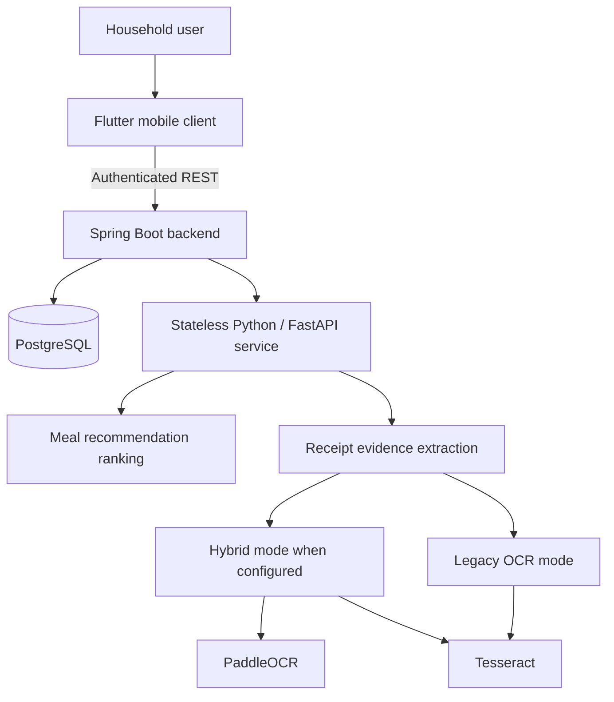
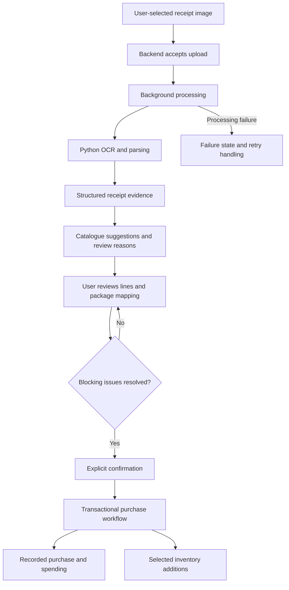
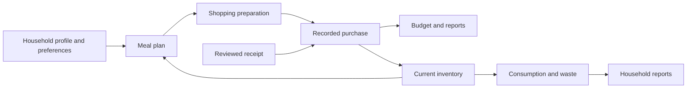

# Architecture

[Back to FEEDO](../README.md)

## System boundaries

The mobile app presents household workflows. The backend authorizes access, validates requests, and owns durable business records. PostgreSQL persists those records. The Python service processes supplied recommendation context and receipt images without owning household persistence.

Docker and Docker Compose support service packaging and local orchestration. This diagram describes responsibilities, not a public deployment topology.

## Receipt processing pipeline

Extraction does not itself create a purchase. Ambiguous financial evidence, unresolved food eligibility, incompatible units, and unmatched product rows can require user action. Review separates an OCR suggestion from an accepted household record.

Background work has ownership of an attempt and failure handling. Receipt-scoped confirmation checks distinguish a repeat request from a conflicting attempt, protecting purchase and inventory effects against duplicate confirmation.

## Conceptual data flow

These are product relationships, not a database schema. A shopping estimate is not recorded spending. Receipt confirmation joins the ordinary purchase workflow so selected stock additions and financial recording follow consistent rules.

## Trust and privacy

The client communicates with the backend rather than directly modifying persistence. Authenticated ownership checks scope household access. OCR output is treated as uncertain input and validated before confirmation. Image handling belongs to the private application; no receipt photographs, service addresses, deployment secrets, or database structures are included here.
